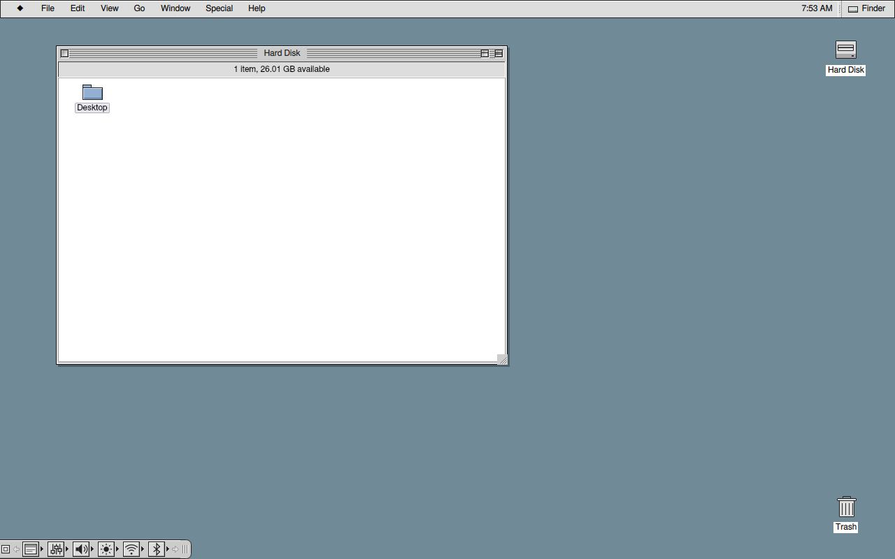

# Platinum Reality

**A classic Platinum desktop for Linux.** Platinum Reality brings back the look and feel of
Mac OS 9 — the menu bar with its application menu, WindowShade title bars, the Control Strip,
spatial Finder windows, Platinum push buttons and alerts — as a real desktop for running modern
Linux applications: Firefox, Chromium, Steam, your terminal, your games.

It is its own Wayland compositor (built with Qt 6), not a theme on top of another desktop, and not
an emulator: no Apple software runs, and none is included.



> **Status: early.** It is used daily on one machine and passes a large automatic test suite, but
> it has been tried on very little hardware. Expect rough edges, and keep another desktop installed.

## What you get

- **The menu bar**: the Apple menu, the active application's menus (where it exports them: Qt
  applications with plasma-integration), the clock and the application menu to switch, hide and
  show applications.
- **Platinum windows**: title bars with close, zoom and WindowShade boxes that press in like the
  originals; one click to activate, then click through; dialogs stay with their windows.
- **Finder**: spatial folder windows, icon and list views, Trash and Put Away, drag and drop
  (Option to copy), Cut, Copy and Paste of files, Get Info, Find, and **View ▸ Show Hidden Files**.
- **Control Strip**: sound, brightness, monitors, battery, **Wi-Fi networks** (through iwd) and
  **Bluetooth** (through BlueZ), each a pop-up menu like the 9.2.2 modules.
- **The Platinum lock screen**, with fingerprint unlock where your system allows it.
- **Appearance**: desktop pictures, accent colour, sounds, WindowShade speed.
- **X11 applications and games** through a bundled, patched xwayland-satellite.
- **An optional startup screen**: a gray 1-bit screen with a smiling computer instead of boot text.

## Install (Arch Linux)

> **Install it on a fresh Arch Linux installation.** That is what Platinum Reality is built and
> tested on. On a system that has been used for a while, other desktops, themes, display settings
> and leftover configuration can interfere in ways nobody has tested, and the glitches may only show
> up later. A ready-made Arch-based system with Platinum Reality set up from the start is planned,
> so that installing it is one step on a clean machine.

```bash
git clone https://github.com/psn-tch/platinum-reality.git
cd platinum-reality
python3 scripts/package-arch.py --output ~/platinum-reality-package
cd ~/platinum-reality-package
makepkg --config ./makepkg.conf -si
```

`makepkg -s` installs the build dependencies; the build compiles the desktop and the X11 bridge
from source and runs the automatic tests (add `--nocheck` to skip them).

## Start it

- **From your login screen** (SDDM, GDM, greetd, LightDM): log out, choose **Platinum Reality**
  from the session list, and log in. Everything you need for a whole session (sway as the display
  backend, swayidle, swaylock for the lock screen's password check, Xwayland) is a dependency.
- **In a window inside your current desktop**, to try it first: run `platinum-reality`.

To leave, choose **Special ▸ Log Out** from the menu bar.

New here? [Your first session](docs/first-session.md) covers the keyboard, opening applications,
settings, and what to do if something goes wrong.

## Make it yours: your own Mac OS 9 sounds, icons and pictures

Platinum Reality ships only original drawings and sounds. If you own a Mac OS 9 installation — for
example the disk image of a virtual machine — you can import its alert sounds, Platinum interface
sounds, Finder icons, desktop pictures and cursors into your own private folder
(`~/.local/share/platinum-reality/assets`), where Platinum Reality finds them at runtime:

```bash
python3 scripts/import-macos9-assets.py ~/path/to/macos9.qcow2
```

Imported files stay on your machine and are never copied into the project. You can also add:

- `startup-chime.wav` (or `.aiff`, `.flac`): played once per boot when the Log In appears.
- `happy-mac.png`: your own black-and-white startup icon for the startup screen.

## The startup screen (optional)

```bash
python3 scripts/boot-splash.py render
sudo python3 scripts/boot-splash.py install --from ~/.local/share/platinum-reality/boot-splash
```

This installs Plymouth if needed and replaces the boot messages with a gray 1-bit screen and a
smiling computer (yours, if you imported one). It currently supports systems that boot a unified
kernel image built by mkinitcpio (`/etc/kernel/cmdline`). Everything it changes is backed up;
`sudo python3 scripts/boot-splash.py uninstall` puts it all back. For a display mounted sideways,
the picture follows the `fbcon=rotate:N` kernel option, or pass `--rotate`.

## Build from source (development)

```bash
cmake -S . -B build -G Ninja && cmake --build build
ctest --test-dir build                     # unit and component tests
bash scripts/run-nested.sh                 # the desktop in a window
```

The full native test suite runs real applications on a private headless display; see
[build and run](docs/build-and-run.md) and [architecture](docs/architecture.md).

## How this was made

Platinum Reality was made with AI. psn_tch had the idea, decided what it should do and how it
should feel, used it every day as their real desktop and reported what was wrong. Almost all of
the code, tests and documentation were written by AI coding assistants working from that
direction: Anthropic's Claude (in Claude Code) and OpenAI's Codex. The title-bar drawings come from
psn_tch's own PlatinumWayland project.

Every change goes through the automatic test suite, including tests that run real applications
(Firefox, Chromium, games, terminals) on a private display, and Mac OS 9 behaviour was compared
against a real Mac OS 9.2.2 running in an emulator. That is not the same as years of use on many
machines: if something is wrong, please open an issue.

## Licence

Platinum Reality's own code is [MIT](LICENSE): take it, change it, build on it, share it. A built
desktop links Qt Wayland Compositor (GPL-3.0), so shared builds follow GPL-3.0 as a whole. The
title-bar drawings come from PlatinumWayland (MIT, see `src/desktop/titlebar/LICENSE-PlatinumWayland`);
the X11 bridge is xwayland-satellite (MPL-2.0), built from its published source with a recorded
patch. See [NOTICE](packaging/NOTICE).

Mac OS, Macintosh and the Happy Mac are trademarks of Apple Inc. Platinum Reality is an independent
project, not affiliated with or endorsed by Apple.
