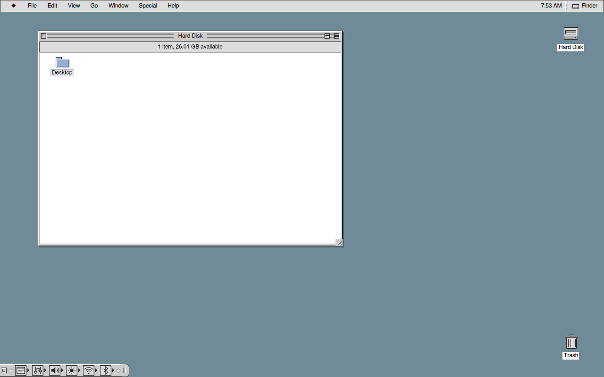

# Platinum Reality

**A classic Platinum desktop for Linux.** Platinum Reality brings back the look and feel of
Mac OS 9 — the menu bar with its application menu, WindowShade title bars, the Control Strip,
spatial Finder windows, Platinum push buttons and alerts — as a real desktop for running modern
Linux applications: Firefox, Chromium, Steam, your terminal, your games.

It is its own Wayland compositor (built with Qt 6), not a theme on top of another desktop, and not
an emulator: no Apple software runs, and none is included.



> **Status: early.** It is used daily on one machine and passes a large automatic test suite, but
> it has been tried on very little hardware. Expect rough edges, and keep another desktop installed.

## What you get

- **The menu bar**: the Apple menu, the active application's menus (where it exports them: Qt
  applications with plasma-integration), the clock and the application menu to switch, hide and
  show applications.
- **Platinum windows**: title bars with close, zoom and WindowShade boxes that press in like the
  originals; one click to activate, then click through; dialogs stay with their windows.
- **Finder**: spatial folder windows, icon and list views, Trash and Put Away, drag and drop
  (Option to copy), Cut, Copy and Paste of files, Get Info, Find, and **View ▸ Show Hidden Files**.
  Right-click and long-press menus, Back/Forward, a path you can type, and Places, like Dolphin.
- **Control Strip**: sound, brightness, monitors, battery, **Wi-Fi networks** (through iwd) and
  **Bluetooth** (through BlueZ), each a pop-up menu like the 9.2.2 modules. On a handheld PC running
  [Handheld Daemon](https://github.com/hhd-dev/hhd), a Handheld module sets its controller mode, power,
  fan and charge limit, and turns the **built-in controller** off so an external one is player 1.
- **One clipboard**: what you copy in an application, on the desktop or with a command-line tool
  (`wl-copy`) pastes everywhere, and still pastes after the application that copied it quits.
  **Edit ▸ Show Clipboard** shows it.
- **Platinum dialogs**: the button Return presses has Mac OS 9's thick ring, and the text field
  you are typing in has its focus ring, in applications and on the desktop alike.
- **Help Center** (Help ▸ Help Center, or Command-?), which also opens once on a new account.
- **Screenshots**: Command-Shift-3 puts a picture of the whole screen on the clipboard,
  Command-Shift-4 (or Command-Shift-P) lets you drag across an area for a picture of just that, and Command-Shift-S
  saves one to a file.
- **The Platinum lock screen**, with fingerprint unlock where your system allows it.
- **Stickies** (Apple menu ▸ Stickies): colored notes on the desktop, saved as you type and
  back where you left them at every login; roll them up, resize them, keep one in front.
- **Calculator** (Apple menu ▸ Calculator): a four-function keypad with keyboard entry,
  percentages, and Edit ▸ Copy and Paste, laid out as the Mac OS 9.2.2 Calculator.
- **Note Pad** (Apple menu ▸ Note Pad): eight pages of notes with a turned-up corner to turn them,
  saved as you type.
- **Application Switcher**: drag the Application menu down to tear it off as a palette of running
  applications, as in Mac OS 9.
- **Labels** (File ▸ Label, in the Finder and on the desktop): seven colours for files and folders,
  kept with the file (as the extended attribute `user.platinum.label`).
- **Key Caps** (Apple menu ▸ Key Caps): see what every key types, with Shift and Option.
- **Scrapbook** (Apple menu ▸ Scrapbook): keep copied text and pictures and paste them out again.
- **About This Computer**: system version, RAM and swap, plus live application memory bars.
- **Control Panels** (Apple menu ▸ Control Panels): every panel in one window — Appearance,
  Bluetooth, Date & Time (menu bar clock, calendar), Desktop Picture, Energy Saver (display off
  and sleep), Handheld (the built-in controller on or off, with Handheld Daemon), Keyboard (keyboard layouts with a menu bar keyboard menu, key repeat), Monitors (on/off, resolution, rotation, size, arrangement,
  mirroring), Mouse & Trackpad, Network (Wi-Fi and addresses) and Sound. Changes apply at once.
- **X11 applications and games** through a bundled, patched xwayland-satellite.
- **An optional startup screen**: a gray 1-bit screen with a smiling computer instead of boot text.

## Install

### From the ISO (recommended)

Platinum Reality is its own Arch-based system. Download **`platinum-reality-x86_64.iso`** from the
[newest release](https://github.com/psn-tch/platinum-reality/releases/latest) (or
**[platinumreality.uk/download](https://platinumreality.uk/download)**), check it, and write it to a
USB stick of at least 2 GB:

```bash
sha256sum -c platinum-reality-x86_64.iso.sha256
sudo dd if=platinum-reality-x86_64.iso of=/dev/sdX bs=4M status=progress oflag=sync   # sdX = the stick
```

(On Windows or macOS, a tool such as balenaEtcher or Rufus in DD mode does the same.) Start the
computer from the stick. Platinum Reality runs live from it, and the **Installer** walks you through
it in the Mac OS 9 style: choose the disk, read the information and licence, make your account, and
install. Then restart without the stick.

- **The disk you choose is erased completely.** The Installer lists what is on each disk and asks
  before erasing, with Cancel as the default. Unplug any disk you care about if you're unsure.
- It needs a **UEFI** computer (no legacy BIOS boot), a 64-bit x86 processor, and a disk of at
  least 16 GB. The system can be encrypted with a password you type at startup.
- After installing, **Software Update** (Apple menu ▸ Control Panels) brings new releases.

The ISO can also be verified with the release key in `packaging/release-key.asc`:
`gpg --verify platinum-reality-x86_64.iso.sig platinum-reality-x86_64.iso`.

### On an existing Arch Linux system

> **Use a fresh Arch Linux installation.** That is what Platinum Reality is built and tested on.
> On a system that has been used for a while, other desktops, themes, display settings and leftover
> configuration can interfere in ways nobody has tested, and the glitches may only show up later.
> The ISO above is the simplest way to get a clean system.

As a normal user with `sudo` and a working network (never as root), first update the system and
add the build tools:

```bash
sudo pacman -Syu --needed base-devel git python
```

Then build and install the package:

```bash
git clone https://github.com/psn-tch/platinum-reality.git
cd platinum-reality
python3 scripts/package-arch.py --output ~/platinum-reality-package
cd ~/platinum-reality-package
makepkg --config ./makepkg.conf -si
```

`makepkg -s` installs the build dependencies; the build compiles the desktop and the X11 bridge
from source and runs the automatic tests (add `--nocheck` to skip them).

## Start it

- **From your login screen** (SDDM, GDM, LightDM): log out, choose **Platinum Reality**
  from the session list, and log in. A minimal Arch install has no login screen yet: install and
  enable one first, for example `sudo pacman -S sddm` and `sudo systemctl enable sddm`.
  For SDDM, the package includes a Platinum **Log In** theme: set `Current=platinum-reality` under
  `[Theme]` in a file in `/etc/sddm.conf.d/` (see docs/sddm-theme.md).
  (greetd has no session list of its own; it needs a greeter such as tuigreet set up to read
  `/usr/share/wayland-sessions`.) Everything you need for a whole session (sway as the display
  backend, swayidle, swaylock for the lock screen's password check, Xwayland) is a dependency.
- **In a window inside your current desktop**, to try it first: run `platinum-reality`.

To leave, choose **Special ▸ Log Out** from the menu bar.

New here? [Your first session](docs/first-session.md) covers the keyboard, opening applications,
settings, and what to do if something goes wrong.

## Make it yours: your own Mac OS 9 sounds, icons and pictures

Platinum Reality ships only original drawings and sounds. If you own a Mac OS 9 installation — for
example the disk image of a virtual machine — you can import its alert sounds, Platinum interface
sounds, Finder icons, desktop pictures and cursors into your own private folder
(`~/.local/share/platinum-reality/assets`), where Platinum Reality finds them at runtime:

```bash
python3 scripts/import-macos9-assets.py ~/path/to/macos9.qcow2
```

Imported files stay on your machine and are never copied into the project. You can also add:

- `startup-chime.wav` (or `.aiff`, `.flac`): played once per boot when the Log In appears.
  Sound ▸ Startup turns it on or off and sets its volume.
- `happy-mac.png`: your own black-and-white startup icon for the startup screen.

## The startup screen (optional)

```bash
python3 scripts/boot-splash.py render
sudo python3 scripts/boot-splash.py install --from ~/.local/share/platinum-reality/boot-splash
```

This installs Plymouth if needed and replaces the boot messages with a gray 1-bit screen and a
smiling computer (yours, if you imported one). It currently supports systems that boot a unified
kernel image built by mkinitcpio (`/etc/kernel/cmdline`). Everything it changes is backed up;
`sudo python3 scripts/boot-splash.py uninstall` puts it all back. For a display mounted sideways,
the picture follows the `fbcon=rotate:N` kernel option, or pass `--rotate`.
If the disk is encrypted, the startup screen asks for its password in a Macintosh dialog
(see docs/boot-splash.md).

## Build from source (development)

```bash
cmake -S . -B build -G Ninja && cmake --build build
ctest --test-dir build                     # unit and component tests
bash scripts/run-nested.sh                 # the desktop in a window
```

The full native test suite runs real applications on a private headless display; see
[build and run](docs/build-and-run.md) and [architecture](docs/architecture.md).

## How this was made

Platinum Reality was made with AI. Lily Hewitt had the idea, decided what it should do and how it
should feel, used it every day as their real desktop and reported what was wrong. Almost all of
the code, tests and documentation were written by AI coding assistants working from that
direction: Anthropic's Claude (in Claude Code) and OpenAI's Codex. The title-bar drawings come from
Lily Hewitt's own PlatinumWayland project.

Every change goes through the automatic test suite, including tests that run real applications
(Firefox, Chromium, games, terminals) on a private display, and Mac OS 9 behaviour was compared
against a real Mac OS 9.2.2 running in an emulator. That is not the same as years of use on many
machines: if something is wrong, please open an issue.

## Contact

Platinum Reality is made by Lily Hewitt. Write to **lily@platinumreality.uk**, or open an issue
here. The project's home is **[platinumreality.uk](https://platinumreality.uk)**, and
**[platinumreality.uk/download](https://platinumreality.uk/download)** always leads to the
newest release.

## Licence

Platinum Reality's own code is [MIT](LICENSE): take it, change it, build on it, share it. A built
desktop links Qt Wayland Compositor (GPL-3.0), so shared builds follow GPL-3.0 as a whole. The
title-bar drawings come from PlatinumWayland (MIT, see `src/desktop/titlebar/LICENSE-PlatinumWayland`);
the X11 bridge is xwayland-satellite (MPL-2.0), built from its published source with a recorded
patch. See [NOTICE](packaging/NOTICE).

Mac OS, Macintosh and the Happy Mac are trademarks of Apple Inc. Platinum Reality is an independent
project, not affiliated with or endorsed by Apple.
