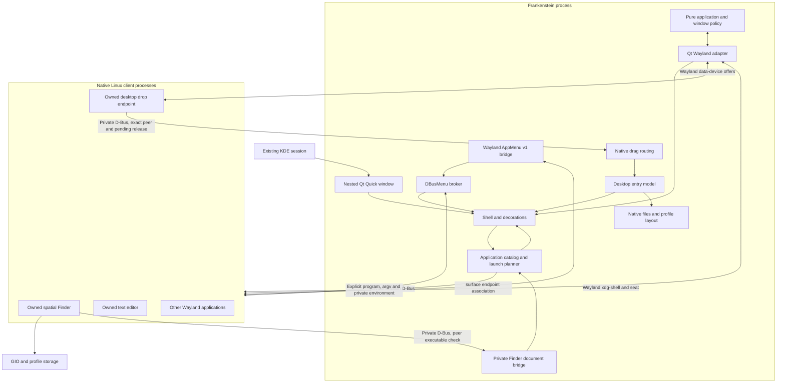

# Current native prototype architecture

2026-10-18 · implemented source, partially qualified execution

The source-only investigation selected River for further audit. River and Zig
are absent locally and source acquisition was unavailable. The first executable
adapter therefore uses installed **Qt Wayland Compositor 6.12.0**. This is an
experimental backend choice, not proof that Qt is the best production foundation.
The pure C++ policy core must remain portable if qualification rejects it.

There is no guest OS, original Finder, Macintosh executable loader or Toolbox.
Frankenstein owns desktop policy; applications run as ordinary Linux processes.

## Responsibilities and boundaries

File drags and right-click menus are deliberate modern conveniences within the
Platinum interaction model. See the [current contract](modern-conveniences.md).
The desktop receiver is a separate private Wayland client because public
QWaylandDrag targets surfaces. Its surface is excluded from rendering, focus,
window grouping and normal application shutdown requests. The manager retires
that owned helper after releasing the view, while protocol infrastructure still
exists. The established renderer/client retirement ordering remains in place.
File work remains in DesktopItems/FileOperations or the destination Finder;
the helper does no file mutation. No new service is installed on the host bus.

| Component | Ownership | Limits |
| --- | --- | --- |
| `src/policy` | Value transitions, identities, grouping, hiding, collapse, modality, menu context | No Qt/process/filesystem/transport calls; historical rules remain provisional |
| `NativeManager` | Admit mapped windows; derive render/focus; configure/close; launch; disconnect cleanup | Application labels are grouping hints, not credentials; native evidence is limited to recorded workflows |
| View lifecycle / `DesktopClientRetirement` | Drain the scene graph, destroy the view, retire connections while protocols live, then destroy protocols/display | Five-workflow native gate passed; no normal-session bypass of save/cancel or general crash-recovery claim |
| `Desktop.qml` | Shell menus, Application menu, desktop selection/dragging, chrome, first-click interception, move/resize | Does not repaint or crop arbitrary client content |
| `DesktopItems` | Directory/identity/selection/layout, notifications, open requests and one asynchronous file job | First 4096 visible entries; partial batches stop at first failure; no full undo or running-job cancellation |
| `ShellDialog.qml` | Naming/errors and token-scoped shell modality | Original provisional controls; not historical geometry certification |
| `WindowRoll` / presentation barrier | Full-size client clipped during shade/restore; input and menu focus withheld until motion ends | Local interpolation/reversal verified; live protocol/input gate pending |
| `AppearanceSettings` / initial Control Strip | Atomic duration/visibility/fold/position preferences; Finder, Applications and Appearance modules | No host configuration changes, audio/display modules or complete classic Control Panel implementation |
| `ApplicationCatalog` | Bounded async desktop metadata discovery, search, launch plans and profile-local associations | Metadata availability is not app compatibility; no D-Bus-only activation or host default changes |
| `DesktopDocumentService` | Owned Finder document requests on the private bus | Live peer executable must match the project Finder; path rechecked; not a general command service or security sandbox |
| Build-local QStyle plugin | Original shared Widgets palette, controls, font and button policy | Matching Qt ABI; programs can override styles; no GTK/Electron repainting |
| `NativeMenuBridge` | AppMenu v1 surface-to-endpoint association | Generated from installed XML; no GTK shell association or v2 claim |
| `MenuBroker` | Async unique-owner/PID validation, bounded decode, snapshot and stale dispatch checks | In-process prototype; separate broker isolation is future work |
| `FinderService` | Per-directory spatial reuse; read-only DirectoryState readiness query on private bus | Per root/profile; cross-process reuse passed the owned native workflow; readiness is diagnostic, not file-operation IPC |
| `FinderWindow` | Folder UI and presentation persistence | Read-only QFileSystemModel; explicit worker operations perform writes |
| `FileOperations` | Staged copying, move/duplicate/rename, Trash and restore | Selected workspace; not a race-proof sandbox or complete volume manager |
| `EditorWindow` | Real UTF-8 editing, clipboard actions, atomic save and close veto | Text up to 16 MiB; no classic binary compatibility |
| Launchers | Private bus/runtime/profile and parent-display connection | No login installation, system power operation or host configuration mutation |

## Window management

Application and window IDs are distinct, monotonic and not reused within a
session. Group activation preserves internal order and remembered selection.
Hiding preserves geometry and collapse; it never suspends a process. Closing
the last window does not remove a still-connected application. Client disconnect
retires registration when no connection still claims it. Admission/fallback
rules are native adaptations, not fully verified 9.2.2 launch behavior.

Collapse changes presentation without reducing client size. Only qualified
server-decorated windows can shade; modal windows cannot. Collapsed
clients receive no keyboard focus. Related modal windows redirect parent
activation and remain above ancestors. Core tests cover these rules; native
popup/input/configure sequencing remains a category-specific gate.

The presentation layer now rolls the bottom edge toward the title bar. Only the
reveal fraction is animated; client size is retained, ordinary resizing is not
animated, and reversal starts at the current visible height. The clip is removed
after full expansion so native popups can extend beyond the window. Duration is
0–1200 ms, default 240, with 120/240/600 ms presets. These are chosen native values,
not authenticated Mac OS 9.2.2 timings or an assertion about its stock speed UI.

During motion the adapter temporarily withholds seat focus, client event delivery,
resize/zoom and exported-menu dispatch. Completion reconciles against current
policy, rather than blindly focusing a previously active window. Shade reversal,
title movement, hiding/switching and close requests remain possible. The initial
Control Strip folds on a handle click, moves by handle drag and persists its
state; exact original modifiers, geometry and modules remain research questions.

Zoom is a reversible size preset, not content-aware classic standard zoom.
Resize respects observed min/max hints. Owned title dragging updates policy
coordinates. CSD-initiated movement and all native activation acknowledgments
still need runtime evidence. Clients may change their actual content size
independently of collapse.

Chrome capabilities now derive from client minimum/maximum sizes and modality.
Fixed-size windows have no grow or zoom box; single-axis constraints survive a
resize. Modal alerts have a plain title bar without close/zoom/shade boxes and
initially center over their parent, clamped to the output. Resizable modal pickers
retain a grow box. These are native presentation decisions awaiting historical
qualification; client-owned decorations remain outside this mechanism.

Close sends `xdg_toplevel.close` and does not assume success. End Nested Session
requests closure and stays open while clients retain windows; it does not kill
clients past save/cancel. This is not yet complete session inhibition, application
quit negotiation or crash recovery. Exit timers are smoke-test aids, unsuitable
for real unsaved documents.

Shell-owned dialogs hold monotonic modal tokens. While any token is held, client
keyboard delivery, normal shell menu/activation and frame interaction are blocked.
Nested dialogs release only their own tokens; a stale close cannot release another
dialog. Normal nested-session exit also waits for shell dialogs and desktop jobs.
These guards are native adaptations, not proof of original Macintosh modality or
protection against forced compositor termination.

## Menus and application compatibility

The actual broker is narrower than the future contract in
`src/interfaces/menu_model.hpp`. A surface supplies a DBusMenu endpoint. The
broker resolves its unique owner and requires the D-Bus process ID to match the
Wayland client. Window/owner changes invalidate endpoint generations; accepted
models advance local snapshot revisions, including property-only changes. Old
async replies cannot replace newer requests. Duplicate IDs, excessive depth,
item counts and decoded label sizes are rejected. Labels render as plain text.

This does not bound all memory allocated by the D-Bus transport before decoding,
isolate hostile providers, implement GTK GMenu/GAction, support every lazy submenu
event or implement every session/broker/tracking field of the future contract.
Those distinctions must survive any production rewrite.

**Qt export is a qualification target, not an established compatibility result.**
An exporter may hide its local menu after seeing a registrar even when the shell
cannot use its endpoint. Registrar presence is therefore not a proven fallback.
That case is a stop condition before deployment. Strict PID checks may reject
helper-process endpoints; supporting them needs authenticated association rather
than relaxed ownership guessing.

Menu endpoint ownership and active interaction context are distinct. An active
dialog lacking an endpoint walks explicit same-application parent relationships;
the selected ancestor's surface/PID still authenticates its endpoint. No endpoint
is inferred from an application label or matching PID alone. Its menu remains
visible while a modal alert is active, but the broker refuses invoke/prepare and
the shell disables exported menu interaction. A focus/modal context change advances
the local snapshot revision, so actions captured before the alert remain stale
after Cancel. This conservative adaptation does not implement every classic modal
Edit-menu exception. The 04:03 functional native workflow passed these assertions.

| Client category | Current path | Remaining work |
| --- | --- | --- |
| Owned Qt Widgets | Platinum-style content, ordinary QActions; live export/input/save/modal workflow passed | Broader controls, tracking, popups and fallback |
| Other Qt | Private display, KDE platform theme and build-local Widgets style | Per-version/app qualification, opt-outs and failed export |
| GTK | Native Wayland window path only | GTK shell metadata, optional GMenu/GAction; retain CSD |
| Electron | Unqualified | Verify actual build/backend/export; app-specific integration where needed |
| X11 | No inherited host `DISPLAY` | Dedicated Xwayland/XWM, not attachment to host X server |
| CSD/self-drawn controls | Content retained | Modern chrome may remain; generic faithful replacement is unavailable |
| No exported menu | No invented File/Edit actions | Preserve real application controls; adapt only through real APIs |

## Applications and documents

The main executable supplies installed XDG application roots; tests supply only
fixture roots. Discovery is lazy, read-only and asynchronous. User entries mask
lower-priority IDs, including Hidden entries. OnlyShowIn/NotShowIn use the explicit
Frankenstein identity. NoDisplay handlers can appear for matching documents.
Limits are 8192 visited entries/directories, 4096 application records, 512 KiB per
entry, and about 64 MiB of read metadata (at most one entry beyond that budget).
MIME matching caches one document classification rather than repeatedly reading
its content for every catalog row. Slow filesystem I/O has no cancellation yet.

GLib GKeyFile reads desktop metadata; original code tokenizes Exec according to a
supported subset of the freedesktop grammar. Field codes expand only after token
boundaries are established. QProcess receives an explicit executable and argv;
document names are never spliced into a generated shell command. Metadata may
explicitly name an interpreter: trusted installed entries remain executable code,
not a sandbox. Unsupported/ambiguous field codes and quoted field substitutions
are rejected. The entry's fingerprint is rechecked before launch. This is not an
atomic lock against concurrent executable replacement.

Launches remove inherited host X11 and stale activation tokens, set the private
Wayland display, use profile-local XDG data/config/cache, and opt matching Qt apps
into build/plugins/styles. No plugin is installed. An application can still access
normal user files, reuse its own external IPC, ignore XDG directories, or fail
after starting. Terminal wrapping currently supports installed Konsole only.
D-Bus-only application activation has no fallback unless Exec is present.

Finder emits document intents instead of invoking the host default opener. Its
private service checks the incoming D-Bus peer PID's live /proc executable against
the owned Finder binary, then rechecks the file's workspace/Trash boundary. App ID
labels do not authorize this bridge. At most 64 document requests wait behind
shell modal tokens. Open With releases its token and dispatches its selection
before the next queued picker. Preferences are atomic associations.json under the
project profile; host MIME defaults are untouched. Desktop-entry documents always
use Editor. A stale or failed preferred handler reports an error; explicit Open
With permits choosing a replacement. New records are not a classic Desktop Database.

Owned Editor file pickers are Widgets dialogs so private sessions do not depend
on a host portal. They remain modern file pickers. Editor rejects unsupported
UTF-8/NUL input and reads at most 16 MiB plus one byte; rejection clears the original
save path. Other applications own their own file dialogs and keyboard shortcuts.
The MacLayout button order, default-action outline, checkbox drawing and font
selection are provisional native policy, not a verified OS 9.2.2 measurement.

The renderer now adds outer Platinum chrome only for negotiated server-side
decorations. CSD/frameless content gets no second title bar or grow box and cannot
WindowShade. A synthetic frameless Qt probe is in the new native gate; real GTK
header bars, client-initiated move/resize and Electron still require qualification.

## Files and persistence

`var/profile` contains Finder state, child XDG directories and private Trash.
Per-folder keys currently hash canonical paths: they are not stable across
external renames or volume moves. Icon placement uses content coordinates rather
than viewport coordinates. Complete desktop/session restoration is absent.

Copies stage in a hidden sibling and publish after success without overwriting
collisions. Symlinks copy as links; symlinked parents cannot direct writes outside
the workspace. Enumeration failure fails the copy instead of publishing an empty
folder. Directory metadata uses an explicit mode/timestamp subset; regular-file
metadata uses GIO. ACL/xattr fidelity, special files, cross-device directories,
per-volume Trash and failure durability need qualification. Multi-item operations
may partially complete before a reported error; they are not transactions.

## Rendering and evidence

Icons/chrome are original code drawings, except the optional user-installed Apple
menu emblem. The UI requests locally installed Charcoal, with DejaVu Sans fallback;
document monospace and the geometric alert glyph retain their separate font roles.
No font file, Apple icon payload, sound or ROM is bundled. The menu reads
profile/assets/apple-menu.png when supplied, otherwise the local NineIcons
16-pixel distributor-logo.png. Neither is copied. Geometry, typography and
control styling are provisional; Fusion-derived Widgets remain visible. Desktop
icons are original Canvas drawings. The entry model is an initial slice of desktop
behavior. Control Panels are not
advertised behind a fake command.

The historical register remains authoritative about evidence quality. Still
images do not prove transitions, and 9.0/9.1 documents do not become exact 9.2.2
evidence through implementation. Native compatibility, appearance and historical
behavior require separate acceptance.

Owned Widgets suppress dialog-button theme icons and draw original geometric
monochrome alert icons. Fusion-derived control geometry, typography and button
ordering remain provisional. The native save alert is a functional QMessageBox,
not a screenshot or a copied Apple resource.

## Native qualification refinements

The 1.5x live capture exposed that Qt's default implicit surface dimensions are
expressed in output pixels divided by the outer window DPR. ClientSurface.qml
normalizes the complete surface subtree into shell logical units, retaining
matching input mapping and avoiding root-size rounding. Frame/body equality,
far-edge clicks and visible global-menu execution passed on the live machine.
This does not yet certify every popup, subsurface or dynamic output transition.

ClientSurfaceItem uses public Qt subclassing for a narrow Qt 6.12 Meta-modifier
adaptation. Qt's modifier-repair representation omits Meta although its native
window-system handler maintains full XKB state. The adapter preserves that native
state instead of letting the repair clear it. The workaround is version-bounded
and must be re-audited on another Qt minor version. Shell/native tests use test-only
QtGuiPrivate window-system injection so modifier bookkeeping matches hardware;
production binaries do not link that private module.

Both nested launchers use an activation-free same-user bus and nonrecursive runtime
cleanup. The interactive profile/workspace persists; each runtime is disposable.
Full application/portal/session lifecycle design remains open.

## Desktop ownership and entries

The shell keeps a logical Finder registration after its folder processes exit.
Desktop activation selects that application without focusing an old folder window;
the shell owns keyboard input. Application-menu selection restores the remembered
folder selection. Finder modality blocks desktop activation. These explicit native
contracts still require historical corroboration.

`workspace/Desktop` is a normal, case-sensitive Linux directory, a native adaptation.
`profile/desktop.json` stores positions and presentation identity independently of
file contents. Linux statx device/inode/birth identity follows ordinary renames when
available; name matching preserves placement for atomic replacement at the same
name. Identity matches win when a file moves and a new file appears at its old name.
Hard links remain distinct, with narrower rename guarantees. No original Macintosh
alias or Desktop Database is implemented. Finder's per-folder path keys above are
unchanged by this desktop-only model.

Layout loading is workspace-scoped, limited to 32 MiB and bounded entry counts.
The shell shows up to 4096 entries; the Desktop folder exposes the rest. Directory
enumeration still materializes its listing, and crowded desktops can overlap.
Dense-layout behavior and performance are not qualified. Resize temporarily clamps
displayed coordinates without overwriting stored ones. Presentation IDs never
authorize opening files. Replacement followed by a rename before state persistence,
unsupported birth times, hard-link changes and mount changes need broader coverage.

Background clicks, Shift selection, group movement, Open, Select All and Clean Up
are joined by folder creation, rename, duplicate and recoverable Trash. Folder/text opens use owned native clients; unsupported
file types report incomplete application associations. A `.desktop` file is never
executed as a program by the entry model.

Desktop jobs capture selected paths and run the same FileOperations backend as
Finder on a worker thread. A completion refresh waits for the job and updates
selection only if the user has not changed it. Partial batches retain completed
items and report the failure; they are not transactions. Watcher resets defer
during jobs, and identical refreshes preserve an active icon drag.

Internal drops onto eligible directories move, Alt-drops copy, and Trash drops
use private recoverable storage. Escape and failed drops restore source placement.
No external Wayland data-device drag is claimed. Linux filename extensions survive
duplicate naming as a native association adaptation. Rubber-band selection,
inline rename, running-job cancellation, full undo and stable references remain
open. The operation/dialog slice passed the combined four-workflow native gate
at 1.5x in the 02:33 run, before subsequent source changes.

Shell menu commands dispatch in the surviving root scope: closing the menu can
destroy its delegate immediately. The first new native workflow exposed this
lifetime defect; the regression now clicks the real New Folder/Rename entries.

## Event delivery refinements

The adapter coalesces outgoing Wayland flushing after input, focus, configure and
close requests, without recursively dispatching client requests. Qt ordinarily
flushes when the event loop blocks; polling/nested loops may miss that boundary.
After the 01:08 resize deadline failure, the next native run delivered the resize
in 50 ms but exposed additional menu/focus timing defects. Overall qualification
remains separate from that individual improvement.

Exported menus now expose pending preparation/loading, disable interaction while
busy and avoid rebuilding an identical model with an identical provider revision.
Real model/provider-revision changes still invalidate action snapshots. Tests wait
for completed preparation, popup opening and usable geometry before clicking.
Window delegates use explicit FocusScopes so removing a modal window can restore
its parent's input target. The 01:57 native run passed all three workflows,
including visible menu execution and the editor's actual keyboard target after
Cancel. This is a bounded prototype result; broader provider/popup/lifecycle
coverage remains open.

## Renderer and connection teardown

A failed 03:59 native workflow crashed while the render thread released a client
buffer after display/resource teardown. Production and native fixtures now keep
the compositor alive longer than the view. A scoped cleanup clears QML references,
disables scene-graph/graphics persistence, hides the view and releases resources
while the manager/output/display still exist. The view destructor joins its
renderer before DesktopClientRetirement retires remaining connections through Qt's
public destroyClient API. Protocol owners survive that retirement; the display is
destroyed last. The 04:03 teardown test found
that relying on display destruction alone left a probe connected; the explicit
retirement revision hung in 04:06 when placed after protocol destruction. Its
current placement before protocol destruction passed in the 04:12 five-workflow
gate, including connected-client shutdown and abrupt probe exit. No timing sleep
or recursive request dispatch is used to manufacture cleanup. It is one bounded
native result, not qualification of every driver or client-disconnect race.

Connection retirement is applied as a batch: remove all windows/claims for a dead
client before synchronizing native focus, menus or configure requests. A surface
can outlive its client; live peer lookup treats that state as unavailable and
clears menu credentials. This corrects the multi-window Finder close crash without
changing renderer/display destruction ordering.

## Desktop source to owned folder window

Shell icons are not Wayland data-device clients. Their original selected paths
are captured once by DesktopItems::beginWindowDrop, and source positions are
restored before any transfer. The manager hit-tests actual stacking, content
bounds and the owned Finder executable, and matches the live Wayland client PID
to the unique profile Finder service owner. A bounded asynchronous DropDirectory
query carries the surface resource ID and client-local coordinates. Finder
accepts only the authenticated desktop bus owner, matches its visible window,
and resolves the current icon/list viewport or child folder. Headers, status
areas, modal/busy windows and stale surfaces do not become drop destinations.
The response is revalidated against the original peer/surface before an async
copy/move job starts. No title matching or source deletion on transport success
is involved. Failure clears the pending operation and retains the source.

`window_surface_id.cpp` is an explicitly version-specific adapter: only the
Wayland platform with Qt 6.12.0 interprets QWindow::winId as its wl_surface proxy
and reads wl_proxy_get_id. Public headers are used, but the WId representation
is not a portable public contract. Unsupported versions return zero. The 10:58
native run qualifies this bridge on the installed version, not future Qt builds.

## Marquee selection

DesktopItems owns the transient rectangle, the pre-gesture set and an optional
additive base. QML's background MouseArea retains the left-button grab while
DesktopItems intersects bounded entry rectangles with the normalized selection
area. The overlay has no input handlers and sits below managed windows. Release
keeps the selected group; Escape or cancellation restores the pre-gesture set.
A changed file listing cancels the gesture and removes stale identities. Neither
selection nor cancellation mutates file contents or icon placement. Pressing an
already-selected icon preserves its group for the existing file-transfer path.
Finder uses Qt's ExtendedSelection with a visible icon-view rubber band. These
are deliberate native convenience policies, not verified target defaults.
